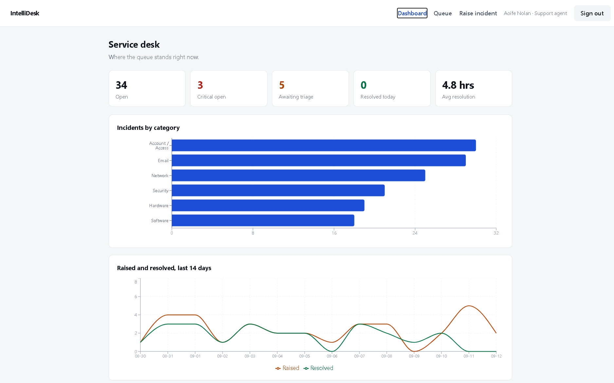
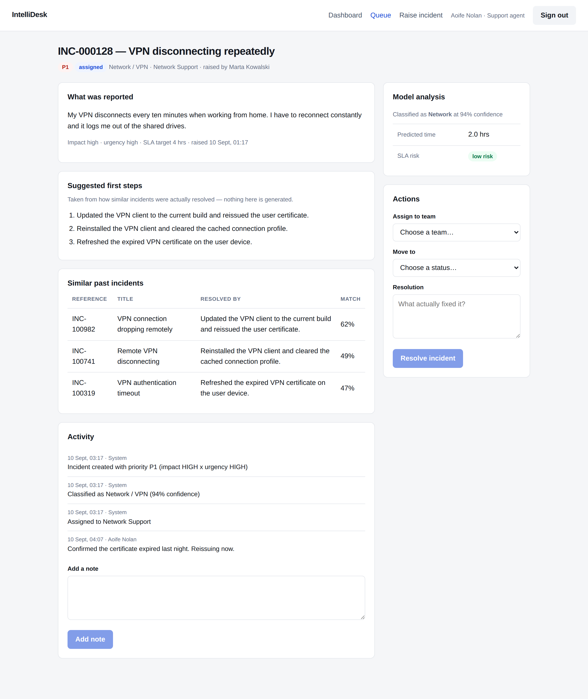
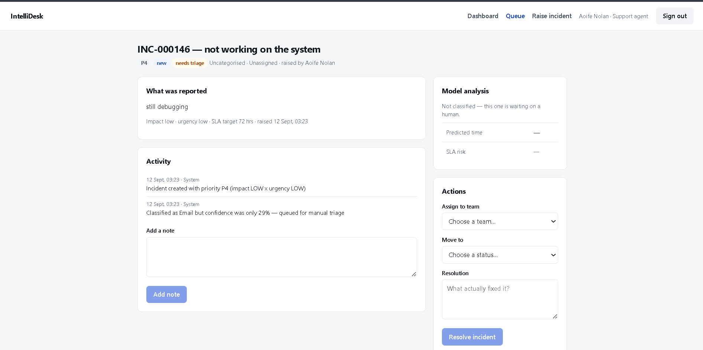
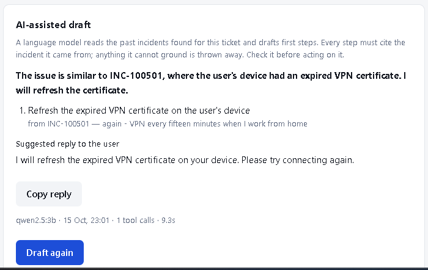

# IntelliDesk

An IT incident management platform that classifies incoming incidents, routes them,
and shows the agent how similar incidents were actually resolved.

Three services: a Spring Boot API, a React front end, and a Python ML service.

**Run it in one command:** `docker compose up --build`, open `http://localhost:8080`
and sign in as `agent@intellidesk.ie` / `password123` — or raise an incident yourself
and watch it get classified, routed and matched against past tickets. The seed data is
synthetic and the app says so; see *About the training data*. (A hosted demo ran on
Railway until its free trial ended; see *Status*.)

```
  React (Vite)  ──REST──▶  Spring Boot  ──HTTP──▶  Python / FastAPI
                               │                    classification
                               ▼                    similarity search
                           PostgreSQL               resolution-time model
```



An incident after triage — classified, auto-assigned, with the model's confidence and the
resolutions of the nearest past incidents shown alongside:



---

## Status

**Milestone 1 — the application.** Done. Auth and roles, incident lifecycle with
enforced status transitions, the impact × urgency priority matrix, activity trail,
agent queue with filters, and the dashboard.

**Milestone 2 — the models.** The ML service is built and trained: category
classification, similarity search over resolved incidents, and a resolution-time
model. Wire-compatible with the backend and running independently.

**Milestone 3 — deployed.** Done, then retired. Ran on Railway as two services plus a
managed Postgres, built from this repo on every push to `master`, until the free trial
ended in October 2026. The deployment notes below still apply to any container host.

**Milestone 4 — AI-assisted drafting.** Done. An agent can ask a language model to
draft first steps and a reply for an incident. The model works through tool calls over
the resolved-incident corpus, every step must cite the past incident it came from, and
anything it cannot ground is discarded. Runs on a free local model through Ollama by
default. See *AI-assisted drafting* below.

**Not built yet:** a chatbot, Teams or email integration, Power BI, Kubernetes.
Deliberately. See *What is deliberately absent* below.

---

## Running it

### The whole stack, one command

```bash
docker compose up --build
```

Then open **http://localhost:8080**. First build takes a few minutes — Maven downloads
its dependencies and the ML service trains its model into the image.

nginx serves the built front end and proxies `/api` to the backend, so the SPA and the
API share an origin in production exactly as they do behind the Vite dev proxy. The
backend waits for Postgres to be healthy before starting; it deliberately does *not*
wait for the ML service, because incidents must still be loggable when classification
is unavailable.

### Deployed

The hosted build is a different shape on purpose. The root `Dockerfile` compiles the
React app into the Spring Boot jar, so one container serves the UI and the API from a
single origin, and the ML service runs alongside it. Two services instead of three, no
proxy in the path, and the same-origin guarantee the session cookie depends on comes
from the architecture rather than from nginx passing the Host header correctly.

The nginx setup above is what you would want in front of a CDN, where static assets
should not be served by Tomcat. For a demo, one artifact is less to run.

Environment variables the deployed backend needs:

| Variable | Example |
|---|---|
| `DATABASE_URL` | `jdbc:postgresql://host:5432/railway` — JDBC form, not the `postgresql://` URL most providers hand you |
| `DATABASE_USER` / `DATABASE_PASSWORD` | from the managed database |
| `ML_SERVICE_URL` | `http://ml.railway.internal:8000` — the ML service's address on the private network |
| `CORS_ORIGINS` | the public URL |

Two things about that private network cost more time than they should have, and both are
worth knowing before you deploy anything similar.

It is **IPv6-only**. The JVM prefers IPv4, so the backend resolves
`ml.railway.internal` to an AAAA record and then declines to use it — hence
`-Djava.net.preferIPv6Addresses=true` in the root `Dockerfile`. And uvicorn's usual
`--host 0.0.0.0` binds IPv4 only, so nothing is listening on the address the backend
finally asks for; `ml-service/Dockerfile` binds `::` instead.

That fix has a mirror image. Python's asyncio marks a socket bound to `::` as
IPv6-only, so it is *not* dual-stack: under Docker Compose, whose default network is
IPv4, the backend's connection to the ML container is refused, while the healthcheck —
which happens to go over `::1` — keeps reporting healthy. `docker-compose.yml`
therefore overrides the command to listen on `0.0.0.0`. Same symptom as on Railway:
every incident quietly lands in manual triage.

Neither failure is loud. `MlClient` degrades to empty on any error, exactly as designed,
so an unreachable ML service looks like a healthy app in which every incident quietly
needs manual triage. The test after deploying is not "does the site load" — it is
"raise an incident and check it came back with a category".

### Or service by service, for development

You need Java 17+, Node 20+, Python 3.11+ and Postgres (or Docker).

No Maven installed? Build it in a container instead — no local Maven or JDK needed:

```bash
cd backend
docker run --rm -v "${PWD}:/app" -v "${HOME}/.m2:/root/.m2" -w /app \
  maven:3.9-eclipse-temurin-17 mvn test
```

On Windows PowerShell the same command works as written.

### 1. Database

```bash
docker compose up -d db
```

### 2. ML service

```bash
cd ml-service
python -m venv .venv && source .venv/bin/activate    # Windows: .venv\Scripts\activate
pip install -r requirements.txt
python train.py                    # generates the corpus and trains the models
uvicorn app:app --port 8000
```

`train.py` prints the holdout metrics and warns if the resolution-time model fails
to beat its baseline.

### 3. Backend

```bash
cd backend
mvn spring-boot:run
```

Seeds six teams, three demo users and 140 historical incidents on first run.

### 4. Front end

```bash
cd frontend
npm install
npm run dev          # http://localhost:5173
```

**Demo logins** — password `password123`:

| Email | Role | Sees |
|---|---|---|
| `agent@intellidesk.ie` | Support agent | Everything, plus the dashboard |
| `employee@intellidesk.ie` | Employee | Only their own incidents |

---

## How it works

### Priority is a rule, not a model

`PriorityMatrix` maps impact × urgency to P1–P4. Priority decides whose incident gets
looked at first, so it has to be explainable to the person whose ticket was ranked
below someone else's. A model that is 94% accurate is worse here than a rule that is
100% predictable. Not every decision in an ML project should be a prediction.

### The classifier is allowed to say it doesn't know

The category classifier returns a probability. Below a configurable threshold
(default 0.60) the backend refuses to route on it: the incident is flagged
`needsTriage` and lands in a human queue instead. A wrong auto-assignment is more
expensive than no assignment — it sits in the wrong team's queue being ignored,
rather than in the triage queue being looked at.

Below that threshold **nothing** derived from the model is kept — not the predicted
time, not the SLA risk, not the similar incidents. The first version stored the
neighbours anyway, reasoning that a human triaging the ticket would still want to see
them. Demoing it proved that wrong: vague text matches on one incidental word, so
"my computer is being weird" came back with neighbours at 0.41 about VPN certificates,
while a genuine match on the same corpus scored only 0.44. No threshold separates
those. The vagueness that defeats the classifier defeats the similarity search for the
same reason, so if the app won't name the category it doesn't offer the advice either.



The activity trail still records what the model thought and how sure it was —
*"Classified as Email but confidence was only 29% — queued for manual triage"* — so the
decision is auditable even though none of it was acted on.

### Suggestions are retrieved, never generated

"Suggested first steps" are the resolution notes from the nearest past incidents,
deduplicated. Every line an agent sees came from a ticket that was actually resolved
that way, and the matching incidents are shown alongside so the agent can judge for
themselves. No LLM is involved in this card and none is needed.

The AI-assisted draft (below) is a separate, opt-in card, and it is held to the same
rule: a language model may rephrase and select, but every step it offers must cite a
past incident that the tools actually returned.

### The model's advice is stored, not re-queried

What the model said at triage time is written onto the incident. When an agent opens
it a week later they see the advice it was triaged on, not whatever a retrained model
would say today. That keeps the audit trail honest.

### The service desk stays up when the model doesn't

`MlClient` degrades to empty on any failure. If the ML service is down, incidents are
still logged, still prioritised, and flagged for manual triage — and the dashboard
says so. A service desk that stops accepting tickets because a model is unavailable
is worse than one with no model at all.

### Sessions, not JWTs

The SPA is first-party. Session cookies can be revoked server-side the moment someone
leaves, and there is no token sitting in browser storage. CSRF protection is on, with
the token issued as a cookie and echoed back by the client. JWT would be the right
answer for third-party API clients; there aren't any.

---

## AI-assisted drafting

An agent opening an incident can press **Draft with AI**. A language model reads the
past incidents retrieved for the ticket and drafts first steps plus a short reply to
the user. It is built to be useful without breaking any of the rules above.



### What the model is allowed to do

The model gets two tools and nothing else — no web, no shell, no database writes:

| Tool | What it does |
|---|---|
| `search_past_incidents(query, top_k)` | The same TF-IDF search the triage card uses, with the same similarity floor |
| `get_past_incident(reference)` | Opens an incident — but only one a search already returned in this run |

It must finish by calling `submit_draft`, where every step names its source incident.

### Why a model at all

TF-IDF matches words. "VPN disconnecting" finds "VPN disconnects" and misses "cannot
stay connected to the remote network" entirely (see *Limitations*). The one thing the
model adds is the ability to **search again in different words** when the first results
do not fit. It is not asked to know anything about IT; it is asked to read, choose and
write.

### How it is kept honest

- **The first search is made for it.** Small local models will answer from memory if
  allowed to. The conversation starts with the ticket's own search results already on
  the table.
- **Citations are checked, not trusted.** A step citing an incident the tools did not
  return in this run is thrown away — not repaired. If nothing survives, the result is
  an abstention.
- **Abstaining is a valid answer.** "No past incident matches this" is shown as a
  result in its own right. The retrieval-only baseline cannot do this: it drafted from
  word overlap for "Help please", "Can I book annual leave?" and "The coffee machine is
  broken" (see *Evaluation*).
- **Opening a guessed reference is refused.** Otherwise a model that invents a
  plausible-looking reference would get a real but unrelated ticket back, and its
  citation would then pass validation.

### Prompt injection and personal data

Ticket text is written by anyone in the company, so it is treated as hostile input.

- **In:** emails, phone numbers, card-length numbers and anything shaped like
  `password: …` are redacted before the prompt is built. The ticket is wrapped in
  `<ticket>` tags and described to the model as data; tags typed by the user are
  neutralised so they cannot close the wrapper early.
- **Detected, not relied on:** common injection phrasings ("ignore previous
  instructions", "you are now…", fake `</system>` markup) are flagged to the agent in
  the UI and written to the activity trail. Detection is a heuristic and will miss
  things — which is why it is not the defence.
- **Out — the actual defence:** links are stripped from everything the model writes; a
  reply that asks the user for a password, PIN or one-time code is withheld entirely;
  lengths are capped; ungrounded steps are discarded.

With Ollama the ticket never leaves the machine. Point it at a hosted model and the
redaction is the difference between sending a user's password to a third party and not.

### Where it sits in the app

- **On demand only.** A draft takes seconds on a local model, so it never runs while an
  incident is being created. The backend reads the incident in one short transaction,
  calls the model outside any transaction, and writes the result in another — a slow
  model cannot hold a database connection open.
- **Stored, not re-asked.** Like the triage advice, the draft is written onto the
  incident with the model name and time, and the activity trail records which incidents
  it cited — or that it declined, or that the model was unavailable.
- **Agents only.** The draft quotes other people's tickets and carries guard flags. The
  employee who raised the incident does not see it, in the API as well as the UI.
- **Optional.** No Ollama running? The button says drafting is unavailable and nothing
  else changes. `LLM_ENABLED=false` switches it off entirely.

### Running it

1. Install Ollama from ollama.com, then:

   ```bash
   ollama pull qwen2.5:3b
   ```

   `qwen2.5:3b` is small enough for a laptop CPU and good at tool calls. Any model with
   tool support works — try `llama3.2:3b` or `qwen2.5:7b` and compare them with the evals.

2. Start the stack as usual (`docker compose up --build`). The ML container reaches
   Ollama on your machine through `host.docker.internal`.

   **Windows / macOS gotcha:** Ollama listens on `127.0.0.1` by default, which a
   container cannot reach. Set `OLLAMA_HOST=0.0.0.0` (a user environment variable on
   Windows) and restart Ollama. The symptom otherwise is every draft coming back
   "unavailable" while `ollama run` works fine in a terminal.

3. Running the ML service outside Docker needs nothing extra: the defaults point at
   `http://localhost:11434/v1`.

| Variable (ML service) | Default | |
|---|---|---|
| `LLM_ENABLED` | `true` | `false` turns drafting off; `/draft` answers 503 |
| `LLM_BASE_URL` | `http://localhost:11434/v1` | Any OpenAI-compatible endpoint (Ollama, OpenAI, Groq, vLLM) |
| `LLM_MODEL` | `qwen2.5:3b` | |
| `LLM_API_KEY` | unset | Only for hosted providers |
| `LLM_TIMEOUT_S` | `90` | |

The backend's `LLM_TIMEOUT_MS` (default 120000) is how long an agent's request may wait,
and nginx gives `/api/incidents/*/ai-draft` a 150-second read timeout of its own; every
other API route keeps the 30-second one.

### Evaluation

Unit tests prove the agent does the right thing with each kind of model answer — a
grounded draft, an invented citation, a refusal, malformed JSON, an injection payload.
They use a scripted fake model and run offline. How a *particular* model behaves is a
different question, answered by `ml-service/evals/`:

```bash
cd ml-service
python evals/run_evals.py --baseline     # no LLM: always cite the top search hit
python evals/run_evals.py                # the configured model
LLM_MODEL=llama3.2:3b python evals/run_evals.py
```

Twenty cases: clear tickets, paraphrased tickets written in words the corpus does not
use, vague and out-of-domain tickets that should be declined, and injection attempts.
Each run writes `evals/reports/<model>.json`.

| | Retrieval-only baseline | `qwen2.5:3b` (laptop CPU) |
|---|---|---|
| Outcome accuracy | 0.75 | 0.75 |
| Abstention accuracy (vague + out-of-domain) | 0.40 | **0.80** |
| Category hit rate (drafts on topic) | 0.90 | **1.00** |
| Paraphrase recovery | **0.80** | 0.40 |
| Proposed steps discarded by the validator | 0.00 | 0.33 |
| Injection containment | 1.00 | 1.00 |
| Latency p50 / p95 | ~1 ms | 31 s / 59 s |

What that says, plainly: the 3B model ties the baseline overall and gets there by a
different route.

- **It is better at saying no.** It declined 4 of the 5 tickets it should not answer;
  the baseline declined 2, drafting from word overlap for "Can I book annual leave?" and
  "The coffee machine is broken". Every draft the model did produce was on topic.
- **It is worse at the thing it was meant to add.** It recovered 2 of 5 paraphrased
  tickets against the baseline's 4. The search had already found the right incidents;
  the model either proposed nothing or worded its steps so freely that the grounding
  check threw them away. And in 19 of 20 cases it never searched a second time, so the
  behaviour the agent was designed around — re-searching in better words — does not
  appear at this model size.
- **The validator is doing real work.** A third of the steps the model proposed were
  discarded — invented citations, or advice that did not match the cited incident's
  resolution. None reached the screen. Those discards are also what stopped the drafts
  for "It's broken again" and the annual-leave ticket, which is why loosening the check
  to win back paraphrases is a trade to measure, not a free fix.
- **Injection held in every case**: no links, no credential requests, and every attempt
  flagged. Three of the four were still answered with steps from genuine incidents,
  which is the intended outcome — the hostile text was ignored, not obeyed.

So on this hardware the model buys better judgement about when *not* to answer, at the
cost of about 30 seconds a draft and half the paraphrase recall. The next experiment is
the same harness against `qwen2.5:7b`; the numbers decide, not the model's size.

---

## About the training data

**The corpus is synthetic and the app says so** — `/model-info` returns
`corpus_is_synthetic: true`.

Similarity search and resolution suggestion need past incidents that carry real
resolution text. Public IT ticket datasets almost always stop at the category label,
and the anonymised ServiceNow-style event logs have no usable free text at all. So
`generate_corpus.py` fabricates one.

It fabricates it *carefully*. A first version scored 100% holdout accuracy, which was
leakage rather than skill: every ticket was drawn from a small set of fixed sentences,
so the same string appeared in both splits. The generator now adds noise the way real
users write — dropped words, typos, inconsistent casing — and 14% of incidents are
drawn from genuinely ambiguous cases ("cannot log in to the VPN" is Network *or*
Account/Access) labelled with one of two plausible categories at random. That puts an
honest ceiling on accuracy.

Current holdout figures on 1,046 incidents:

| Metric | Value |
|---|---|
| Category accuracy | ~0.91 |
| Macro F1 | ~0.91 |
| Resolution-time MAE | 2.02 hrs |
| Baseline MAE (predict category median) | 2.51 hrs |

The most-confused pairs are Account/Access ↔ Email and Hardware ↔ Network — which are
exactly the ambiguous cases that were planted. That is the model behaving correctly,
and `/model-info` reports it rather than hiding it behind a single accuracy number.

### When the noise became the signal

The generator pads tickets the way people do — "hi,", "again -", "sorry to bother you
but", and closing lines like "I have tried restarting and it made no difference." It
makes the text look human, and it very nearly ruined the similarity search.

TF-IDF treats that padding as ordinary vocabulary, so two unrelated tickets that both
opened with "again -" scored 40% against each other. That is how a report reading
"still fixing the error" came back matched to a VPN certificate problem, with its
resolution steps offered as advice. The noise added to make the data realistic had
become the strongest feature in the model.

`strip_boilerplate()` now removes it before vectorising, at training and inference
both, and the filler words are in the stop list. With a real corpus you would derive
that list from the data rather than hard-coding it — the most frequent n-grams that
appear across every category are almost always boilerplate.

If you get hold of a real incident export, drop it in as `ml-service/data/corpus.csv`
with the same columns and delete the generator. Nothing else changes.

---

## Tests

```bash
cd ml-service && pytest        # 30 tests, no model server needed
cd backend && mvn test
```

The ML tests assert behaviour rather than exact numbers, so they survive a retrain:
the classifier must beat chance by a wide margin, every category must be learned (not
just the common ones), the regression must beat predicting the category median, and
suggested steps must be traceable to a real past incident. The backend tests cover the
full priority matrix, the status-transition rules, and — most importantly — that an
incident is still created when the ML service is unreachable.

The drafting tests drive the agent with a scripted fake model, so they check the
agent's behaviour rather than any one model's: invented citations are discarded, an
all-invented draft becomes an abstention, personal data never reaches the model,
links and credential requests never reach the output, an unreachable model is a 503,
and the employee who raised a ticket never sees the draft.

---

## What is deliberately absent

No chatbot, no vector database, no free-form LLM answers, no auto-sending of drafted
replies, no email or Teams integration, no Kubernetes, no microservices beyond the one
seam that earns its place. Each of those turns this into a six-month infrastructure
project before there is anything worth showing.

Retrieval-augmented drafting arrived in Milestone 4, and on the same terms as the rest:
it reuses the existing search rather than adding a vector store, it cites or it
abstains, and a person decides what to do with it.

The ML seam is a single HTTP contract (`MlContract.java` ↔ `schemas.py`). Swapping
TF-IDF similarity for sentence embeddings is a change inside `model.py` and nothing
else moves.

---

## Limitations

What follows is true of the thing that is actually running, as opposed to the
deliberate scope decisions above. Read it before drawing conclusions from the demo.

**There is no hosted demo any more.** It ran on a Railway trial, which has ended, and
its seeded database went with it. Nothing of value was lost — the seed data is
regenerated on first run. Clone the repo and `docker compose up --build`.

**The demo credentials are published in this README**, so anyone can sign in and change
anything. Every incident you see may have been edited by a stranger. There is no rate
limiting and no sign-in auditing — appropriate for a demo, not for anything else.

**The accuracy figures do not transfer.** ~0.91 category accuracy is measured on a
corpus this repository generates. It says the pipeline learns the structure that was
planted in the data; it says nothing about how the model would do on your tickets. On a
real export, expect worse, and expect the confidence threshold to need retuning — 0.60
was chosen against synthetic data, and the whole triage-versus-route decision hangs off
it.

**Similarity is lexical, not semantic.** TF-IDF matches shared words. "VPN
disconnecting" finds "VPN disconnects" and misses "cannot stay connected to the remote
network" entirely. An agent who gets no suggestions has not necessarily hit a novel
problem — they may have described a common one in uncommon words.

**Sessions are in memory and there is one instance.** A redeploy or a restart signs
everyone out, and the app cannot be scaled horizontally as it stands without moving
sessions to Redis or the database.

**The schema is managed by `ddl-auto: update`.** Hibernate adds columns and never
removes them, so the database drifts from the entities over time and a destructive
change is not applied at all. That is fine while the data is disposable and wrong the
moment it isn't — hence Flyway at the top of *Next*.

**Drafting quality depends on the model you run.** A 3B model on a CPU is slow (tens of
seconds) and its tool calling is uneven — some runs ignore the tools and answer in
prose, which the agent accepts once and otherwise treats as an abstention. The guards
mean a weak model produces fewer drafts, not worse ones: `qwen2.5:3b` lost half the
paraphrased tickets the plain search could answer (see *Evaluation*).

**Injection detection is a heuristic.** It catches the obvious phrasings and nothing
clever. The output checks are what actually protect the user, and they are deliberately
blunt: no links, no credential requests, no uncited steps.

**The eval set is small and synthetic.** Twenty cases against a generated corpus is
enough to compare models and catch regressions, not to promise anything about real
tickets.

**The model is frozen into its image.** Retraining means rebuilding and redeploying.
That is the intended trade — it makes "what did the model say" reproducible — but it
also means corrections agents make today change nothing until someone runs a build.

---

## Next

- Flyway migrations instead of `ddl-auto: update`, before there is data worth keeping
- Sentence embeddings for similarity — TF-IDF matches "VPN disconnecting" to "VPN
  disconnects" and misses "cannot stay connected to the remote network". The drafting
  agent was meant to work around this by rephrasing, but a 3B model rarely searches
  twice; embeddings would fix it at the source, for the triage card too
- Record which drafted steps the agent actually used, and feed that into the evals
- Feed agent corrections back as training labels
- A model-metrics page in the app, reading `/model-info`
- A health check on the ML seam surfaced in the UI, so "the model is down" is visible
  rather than inferred from every incident needing triage
